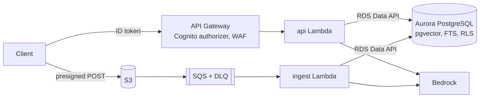

<div align="center">
    <a target="_blank" href="https://www.youtube.com/@genieincodebottle"></a>&nbsp;
    <a target="_blank" href="https://www.linkedin.com/in/rajesh-srivastava"></a>&nbsp;
    <a target="_blank" href="https://www.instagram.com/genieincodebottle/"></a>
    <a target="_blank" href="https://x.com/zero2nn"></a>
    <h3><a target="_blank" href="https://github.com/genieincodebottle/generative-ai/blob/main/GenAI_Roadmap.md">GenAI Roadmap - 2025</a></h3>
</div>

# RAG Platform on AWS

A multi-tenant retrieval-augmented generation (RAG) service: upload documents, ask questions, get answers that cite the exact section of the document they came from, and only from documents the user is allowed to read. It runs on AWS (Amazon Bedrock, Aurora PostgreSQL with pgvector, Lambda, API Gateway, Cognito), and the whole system also runs on a laptop with no AWS account and no API key.

The repository is a reference implementation. The code, the Terraform, the tests, the evaluation set and the guides in [`docs/`](docs/) are written to be read and adapted.

## What it does

- **Answers with checked citations.** Every factual sentence cites a source. The server removes citations to sources the model was not given and refuses answers that cite nothing. When the documents do not hold the answer, it says so instead of guessing; when two documents disagree, it reports both.
- **Isolates tenants and documents in the database.** Identity comes only from verified Cognito tokens. PostgreSQL row-level security filters every row by tenant and by the document's access groups, so a query that forgets a filter still cannot read another tenant's data.
- **Hybrid retrieval.** Vector search (HNSW) and keyword search (PostgreSQL full text) fused with reciprocal rank fusion in one SQL statement, with parent-child chunks, contextual headers and optional Bedrock reranking.
- **Document lifecycle.** PDF, DOCX, HTML, Markdown, text and CSV; type sniffing and size limits; idempotent ingestion through S3, SQS and a dead-letter queue; versions that replace each other atomically; deletion that removes chunks, file versions and cached answers.
- **Bounded agentic mode.** An opt-in planner that splits multi-part questions, with step, token and time budgets and read-only tools.
- **Measured.** A labelled evaluation set (45 questions, two tenants, ACL and injection probes) with regression gates in CI, load tests, and a cost model with sourced prices.

## Results so far

| Measurement | Result |
|---|---|
| Tests | 168, including 46 against real PostgreSQL as a role that row-level security applies to; 82% line coverage |
| Live evaluation (Gemini embeddings and Flash, hybrid) | fact accuracy 1.000, citation precision 0.953, refusal accuracy 1.000, 0 leaks, 0 obeyed injections, p50 3.8 s |
| Agentic mode on the same set | same accuracy, p50 7.5 s, 28% more input tokens, so off by default |
| Platform overhead per question (local, no model) | p50 43 ms, p95 74 ms at 20 users; 76 req/s and 0 failures at 100 users |
| Estimated monthly cost | idle dev about $3.50; 500-user department about $140 |
| Infrastructure checks | Terraform validates (AWS provider 6.70.0); Checkov 232 passed, 0 failed, 30 skipped with recorded reasons |

Not yet verified: a live AWS deployment, and answer quality with Bedrock models. See [Known gaps](#known-gaps).

## Architecture



The functions run outside a VPC and reach Aurora through the RDS Data API, so there is no NAT gateway, and Aurora scales to zero when idle. [docs/architecture.md](docs/architecture.md) covers the request and ingestion flows and the trust boundaries.

## Quick start (local, no AWS, no key)

Prerequisites: Python 3.12+, [uv](https://docs.astral.sh/uv/) 0.9+, Docker.

```bash
git clone https://github.com/genieincodebottle/rag-app-on-aws.git
cd rag-app-on-aws
uv sync --all-extras
cp .env.example .env
docker compose up -d db
uv run ragplatform migrate
uv run ragplatform tenant acme "Acme Corp" --agentic
uv run ragplatform ingest eval/corpus/northwind/*.md --tenant acme --user alice --groups staff --acl staff
uv run ragplatform ask "Who approves an expense claim of 2,000 GBP?" --tenant acme --user bob --groups staff
uv run ragplatform serve          # API on http://127.0.0.1:8000
uv run streamlit run ui/app.py    # UI on http://localhost:8501
```

This uses the offline `fake` providers. For real answers on the free tier, set `RAG_PROVIDER=gemini` and a Gemini key ([setup.md](docs/setup.md)). For AWS, see [deployment.md](docs/deployment.md).

## Guides

| Guide | Covers |
|---|---|
| [Architecture](docs/architecture.md) | components, flows, trust boundaries, trade-offs |
| [AWS service selection](docs/aws-service-selection.md) | each service against its alternatives |
| [Setup](docs/setup.md) | install, configure, verify |
| [Local development](docs/local-development.md) | tests, debugging, working without AWS |
| [Deployment](docs/deployment.md) | bootstrap, GitHub OIDC, deploy, rollback, teardown |
| [Security](docs/security.md) | threat model, controls and their tests, incident response, known gaps |
| [RAG engineering](docs/rag-engineering.md) | parsing, chunking, embeddings, indexing, retrieval, reranking, generation, citations |
| [Agentic RAG](docs/agentic-ai.md) | the bounded agent, tools, budgets, evaluation |
| [Testing and evaluation](docs/testing-and-evaluation.md) | test suite, dataset, metrics, results, load test |
| [Observability](docs/observability.md) | logs, metrics, traces, dashboard, alarms |
| [Operations runbook](docs/operations-runbook.md) | one entry per alarm, routine operations, backup and restore |
| [Cost](docs/cost.md) | scenarios, drivers, budget controls |
| [API reference](docs/api-reference.md) | endpoints, schemas, errors, limits |
| [Troubleshooting](docs/troubleshooting.md) | problems met and how to fix them |
| [Architecture decisions](docs/adr/) | nine ADRs |
| [Current-state assessment](docs/audit/current-state-assessment.md), [plan](docs/plan/implementation-plan.md) | the audit of the previous version and the plan this implements |

## Repository layout

```
src/ragplatform/     the platform (config, domain, ingestion, retrieval, generation, agent, services, api, handlers)
tests/               unit, integration (real PostgreSQL), load
eval/                corpus, dataset, runner, thresholds, reports
infra/terraform/     bootstrap, modules, platform root, envs
ui/                  Streamlit client
mcp_servers/         optional web-search MCP server
scripts/             Lambda bundle build, cost model
docs/                guides and ADRs
```

## Known gaps

- Not deployed to a live AWS account by this repository's test suite. The RDS Data API path, IAM policies and Bedrock calls are contract-tested; the first deployment's smoke test is the live check.
- Answer quality with Bedrock models (Titan V2, Nova 2 Lite) has not been measured; run the evaluation with `--provider bedrock` in a dev account.
- Reranking and the Guardrails grounding check have no measured effect yet.
- No scheduled rotation for the runtime database secret, no Lambda code signing, no OCR for scanned PDFs, no cross-region recovery. Each is listed with its risk in [security.md](docs/security.md) or the [runbook](docs/operations-runbook.md).
- The evaluation set is small and its documents are short.

## Licence

MIT, see [LICENSE](LICENSE).
