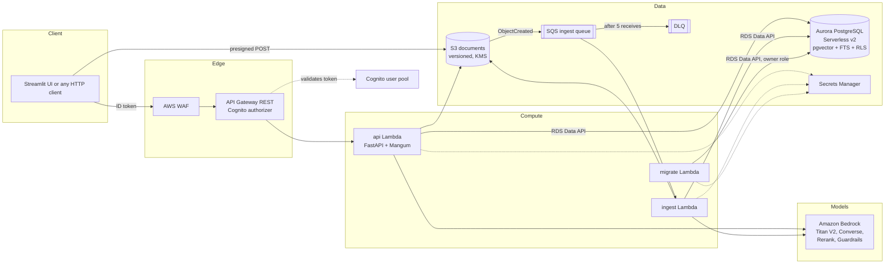
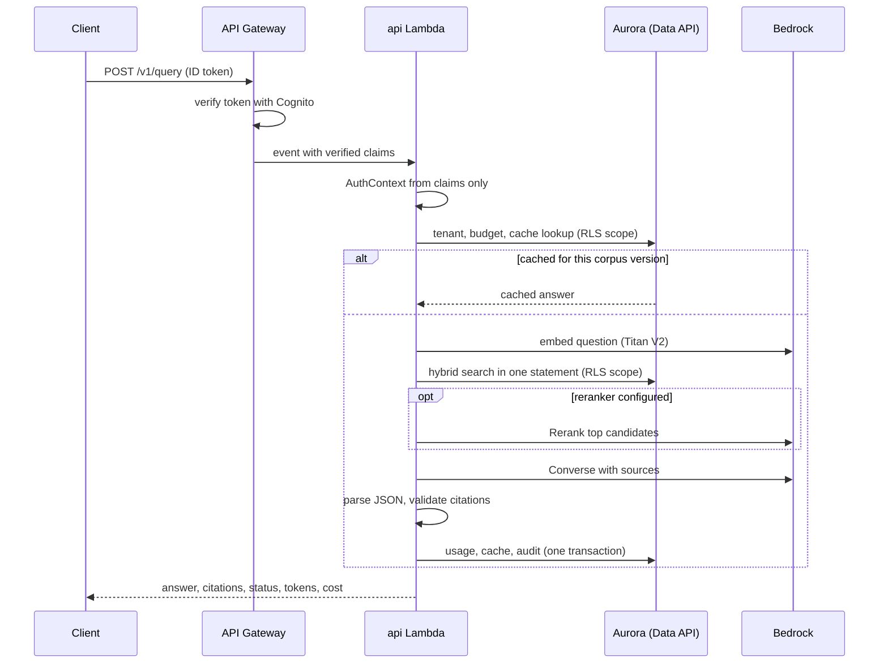
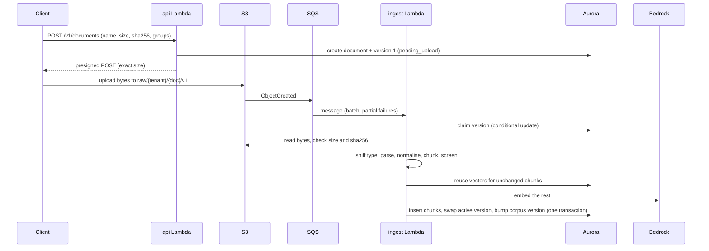

# Architecture

This guide describes the components, how a question and a document move through them, where the trust boundaries are, and the trade-offs behind the shape. Service choices are argued in [aws-service-selection.md](aws-service-selection.md) and the [ADRs](adr/).

## Components



| Component | Responsibility | Code |
|---|---|---|
| API Gateway | TLS, token validation, stage throttling, access logs, optional WAF | `infra/terraform/modules/api` |
| `api` Lambda | All HTTP routes: questions, document registration, listing, access changes, deletion, usage | `src/ragplatform/api/app.py`, `handlers/api.py` |
| `ingest` Lambda | Parse, chunk, embed and activate one uploaded document version per S3 event | `ingestion/pipeline.py`, `handlers/ingest.py` |
| `migrate` Lambda | Apply SQL migrations, create the runtime database role and write its secret | `store/migrate.py`, `handlers/migrate.py` |
| Aurora PostgreSQL | Documents, versions, chunks, vectors (HNSW), full-text index (GIN), cache, usage, audit log | `store/migrations/0001_schema.sql` |
| S3 | Original file bytes, one object per document version | `adapters/blobstore.py` |
| SQS and DLQ | Buffer between uploads and ingestion; failed messages kept 14 days | `modules/storage` |
| Bedrock | Embeddings, generation, optional reranking and Guardrails | `providers/bedrock.py` |
| Cognito | Users, tenant assignment (`custom:tenant_id`), groups | `modules/auth` |

The same Python package runs locally. The API runs under uvicorn, PostgreSQL runs in Docker, files go to a local directory, ingestion runs in-process, and the model providers can be the offline `fake` set or Gemini. [local-development.md](local-development.md) covers that mode.

## Code layout

```
src/ragplatform/
  config.py        settings and the deployed-environment safety checks
  domain/          typed models and errors (no I/O)
  security/        identity from claims, local tokens, injection screening
  ingestion/       parsers, normalisation, chunking, the ingestion pipeline
  providers/       embedder, chat model and reranker ports, with bedrock, gemini, fake
  store/           SQL executors (psycopg, RDS Data API), migrations, repository, re-embed
  retrieval/       hybrid search, reranking, parent expansion, context packing
  generation/      prompt building, answer parsing, citation validation
  agent/           tools with permissions, bounded agent loop, web-search client
  services/        query and document services (the use cases)
  observability/   logging, metrics, tracing, cost estimates
  api/             FastAPI app
  handlers/        Lambda entry points
  adapters/        S3 and local blob stores
  container.py     wiring
  cli.py           local and admin commands
```

Dependencies point inward. `domain` imports nothing from the rest of the package. Services depend on ports (`Database`, `BlobStore`, `Embedder`, `ChatModel`, `Reranker`), and the AWS, local and test implementations are chosen in `container.py`. The same services therefore run against Aurora in Lambda, PostgreSQL on a laptop, and fakes in tests.

## How a question is answered



1. API Gateway rejects requests without a valid ID token. The function builds an `AuthContext` (user, tenant, groups, admin flag) from `requestContext.authorizer.claims`. Nothing in the body or headers can change it.
2. In one transaction scoped to the caller, the service loads the tenant, checks the daily query and token budgets, and looks up the answer cache.
3. On a cache miss the question is embedded and `Repository.search` runs vector search, keyword search and reciprocal rank fusion in a single SQL statement. Row-level security filters every row to the caller's tenant and readable documents.
4. If a reranker is configured, the top candidates are rescored. Matched child chunks are then replaced by their parent sections, and the sources are packed into the context budget.
5. If no source survives, the answer is `insufficient_context` and no model call is made.
6. The model returns JSON with `[S1]` markers. The server removes markers that do not match a supplied source and downgrades an answer with no valid citation to `insufficient_context`.
7. Usage, the cache entry and an audit event (question hash, status, cited document ids) are written in one transaction.

## How a document is ingested



- **Idempotency.** S3 and SQS both deliver at least once. `claim_version` is a conditional `UPDATE ... RETURNING`: only one delivery can move a version from `pending_upload` or `uploaded` to `processing`, and a later duplicate gets no row and stops.
- **Atomic replacement.** A new version's chunks are inserted and the old version's chunks deleted in the same transaction, so a reader sees one version or the other, never a mix. An older version that finishes after a newer one is marked `superseded` and never becomes live.
- **Failures.** A file that can never be processed (wrong type, corrupt, no text, checksum mismatch, over a limit) is marked `failed` with a reason code, and the message is acknowledged. A transient error (throttling, timeout, database resuming) releases the claim and raises, so SQS redelivers the message after the visibility timeout. After five receives it moves to the DLQ, which has an alarm.
- **Embedding reuse.** A chunk whose embedded text matches one already stored in the tenant reuses that vector. A new version that changes one paragraph re-embeds only the chunks that changed.

Deletion runs in the API: one transaction deletes the chunks, tombstones the document (id kept for the audit trail, title and metadata scrubbed) and bumps the corpus version, which invalidates cached answers. Then every S3 version of the file is deleted.

## Trust boundaries

| Boundary | What crosses it | Control |
|---|---|---|
| Internet to API Gateway | Requests from anyone | TLS, WAF managed rules and per-IP rate limit (test, prod), stage throttling, Cognito authorizer on every route except `/v1/health` |
| API Gateway to `api` Lambda | Verified claims | Only API Gateway can invoke the function alias (resource policy). Identity is read from claims and nothing else |
| Client to S3 | File bytes | Presigned POST bound to one key, exact size and content type, 15-minute expiry. The worker re-checks size and SHA-256 |
| Lambda to Aurora | SQL | RDS Data API with IAM plus a runtime-role secret. The role is not the table owner, so row-level security applies to every statement |
| Retrieved text to the model | Untrusted document content | Delimited source blocks with `<` escaped, a system prompt that treats sources as data, injection screening flags, citations checked server-side |
| Model output to the client | Model text | JSON schema validation, citation validation, optional Guardrails grounding check |
| Agent to tools | Model-chosen tool calls | Registered tools only, schema-validated arguments with extra fields forbidden, scope taken from the server context, write tools require an approver |
| Platform to web search | Search queries out, results in | Endpoint fixed in configuration (HTTPS only), bearer key, no redirects, response size cap, results flagged as external |

[security.md](security.md) has the threat model behind these controls.

## Trade-offs

- **Lambdas outside a VPC with the RDS Data API** ([ADR 0003](adr/0003-data-api-instead-of-vpc-lambdas.md)). No NAT gateway, no interface endpoints, no connection pooling. Each statement is an HTTPS call (a few milliseconds more than a pooled connection), responses are capped at 1 MiB, and the Data API cannot pass array parameters, which is why lists travel as JSON text.
- **One store for everything** ([ADR 0002](adr/0002-postgresql-pgvector-as-retrieval-store.md)). Vectors, keyword index, metadata, ACLs, cache and audit log live in one PostgreSQL database. Document updates are transactional and isolation is one mechanism (row-level security). The cost is that very large corpora (hundreds of millions of vectors) would need a dedicated vector service.
- **No streaming responses** ([ADR 0005](adr/0005-validate-answers-before-returning.md)). Citations are validated after the full answer arrives. Streaming tokens to the client would show text the server might then reject.
- **Agentic mode is opt-in** ([ADR 0006](adr/0006-bounded-in-process-agent.md)). On the evaluation set it matched standard mode's quality at about twice the latency, so standard mode is the default.
- **Scale to zero in dev and test.** Aurora pauses after 15 idle minutes. The first request after a pause waits about 15 seconds or gets a 503 with `Retry-After`. Prod keeps 0.5 ACU minimum.
